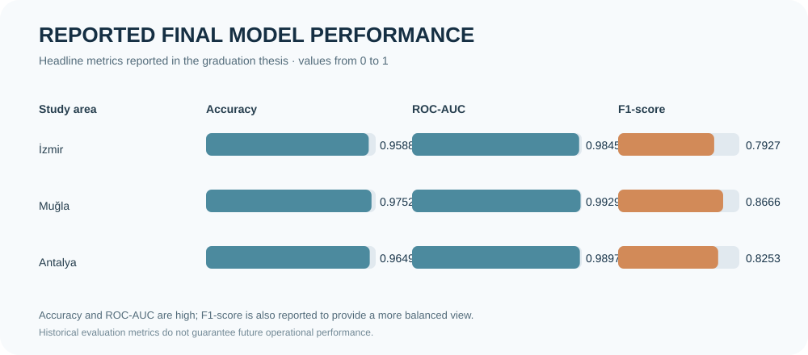

# AI-Assisted Forest Fire Risk Prediction & Decision Support

**Multi-source environmental data · Machine learning · Geospatial risk mapping**

Graduation project for short-term forest-fire risk prediction in **İzmir, Muğla, and Antalya, Türkiye**.

## Project overview

This project combines historical fire records and environmental variables to estimate whether a **2 km × 2 km grid cell** may experience a fire within the following **five days**. It combines spatial-temporal data preparation, feature engineering, model comparison, and a Streamlit decision-support interface.

The thesis describes an interface for selecting a city and date, visualising grid-level risk scores, reviewing summary metrics, and listing the highest-risk cells.

> **Responsible use:** This is a research prototype, not an official warning service. It should not be used as the sole basis for emergency response or public-safety decisions.

## At a glance

| Item | Description |
|---|---|
| Study areas | İzmir, Muğla, Antalya — Türkiye |
| Spatial unit | Approximately 2 km × 2 km grid cells |
| Prediction horizon | Fire occurrence within the next 5 days |
| Target variable | `next_5d_fire` |
| Historical fire data | NASA FIRMS VIIRS active-fire records |
| Vegetation indicator | MODIS MOD13Q1 NDVI |
| Weather | Open-Meteo historical and forecast APIs |
| Models compared | Random Forest, XGBoost, Balanced XGBoost, LightGBM |
| Final model family | City-specific Random Forest variants |
| Decision threshold | 0.60 |
| Interface | Streamlit map-based decision-support prototype |

## Project visuals

The following diagrams summarise the pipeline and the thesis's reported final model metrics.

The thesis also documents three key application views: **the main decision-support screen (Figure 7.5, thesis p. 87), Antalya's grid-based risk map (Figure 7.6, p. 88), and the ranked highest-risk grid cells (Figure 7.7, p. 89)**. Those are references to the original thesis figures; the original screenshots have not yet been added as standalone image files to this repository.

## Methodology

1. **Multi-source data preparation:** historical fire detections, weather, terrain, land cover, NDVI, and human-proximity features.
2. **Spatial-temporal modelling table:** daily observations aligned to approximately 2 km × 2 km grid cells.
3. **Target engineering:** `next_5d_fire` indicates whether a fire occurs in the same grid cell during the following five days.
4. **Class imbalance handling:** the thesis describes retaining all positive observations and sampling negative observations at a 1:10 ratio.
5. **Model comparison:** Random Forest, XGBoost, Balanced XGBoost, and LightGBM.
6. **Evaluation:** accuracy, ROC-AUC, precision, recall, F1-score, and confusion matrices.
7. **Decision-support interface:** city/date selection, grid-level risk visualisation, summary indicators, and ranked high-risk cells.

### Data sources and feature groups

| Group | Role | Reference |
|---|---|---|
| Historical fire activity | NASA FIRMS VIIRS active-fire records | [NASA FIRMS](https://firms.modaps.eosdis.nasa.gov/) |
| Weather | Historical model inputs and forecast inputs for the interface | [Open-Meteo Historical API](https://open-meteo.com/en/docs/historical-weather-api) · [Forecast API](https://open-meteo.com/en/docs) |
| Topography | SRTM-based elevation and terrain characteristics | [OpenTopography](https://opentopography.org/) |
| Vegetation | MODIS MOD13Q1 NDVI | [NASA LP DAAC](https://lpdaac.usgs.gov/) |
| Land cover | Grid-level land-cover characteristics | Source and processing details are described in the thesis |
| Human proximity | Road, settlement, and selected activity proximity indicators | [OpenStreetMap](https://www.openstreetmap.org/) |

Check each provider's current terms, licences, coverage, and attribution requirements before reusing data.

## Reported final results

The following metrics are transcribed from the thesis's city-level final-model comparison (Table 6.7, thesis p. 72). The selected feature configuration differs by city.

| Study area | Selected model | Accuracy | ROC-AUC | Precision | Recall | F1-score |
|---|---|---:|---:|---:|---:|---:|
| İzmir | Common + Road + NDVI Random Forest | 0.9588 | 0.9845 | 0.7302 | 0.8669 | 0.7927 |
| Muğla | Common + Road + NDVI Random Forest | 0.9752 | 0.9929 | 0.8483 | 0.8857 | 0.8666 |
| Antalya | NDVI Random Forest | 0.9649 | 0.9897 | 0.7556 | 0.9092 | 0.8253 |

Random Forest variants provided the strongest final results among the compared approaches in the reported experiments. Muğla achieved the highest F1-score among the three selected city models. Antalya's model reported the highest recall, which is relevant when missed high-risk cells are a concern.

**Interpretation note:** Accuracy can be misleading when fire events are rare. The thesis therefore also evaluates precision, recall, F1-score, ROC-AUC, and confusion matrices. These historical evaluation metrics do not guarantee future operational performance.

## Decision-support concept

The thesis describes a Streamlit interface that accepts a selected city and date, builds prediction features from available weather and recent fire information, generates grid-level risk scores, and displays them on a map. It also documents spatial smoothing:

`RiskSmoothed = 0.70 × RiskRaw + 0.30 × MeanNeighborRisk`

This gives more weight to the original model output while using neighbouring grid risk as a supporting signal.

## Technology and methods

- **Python** — data preparation and modelling
- **pandas / NumPy** — tabular processing
- **scikit-learn** — model training and evaluation
- **Random Forest, XGBoost, Balanced XGBoost, LightGBM** — model comparison
- **GIS / geospatial processing** — grid-based spatial analysis
- **Remote sensing** — VIIRS active-fire records and NDVI features
- **Streamlit** — decision-support interface

## Repository contents and reproducibility

This repository currently contains public-facing documentation, methodology notes, and explanatory SVG diagrams. It does **not** include the complete executable modelling code, raw datasets, trained model binaries, or a verified dependency file. Therefore, the application cannot yet be reproduced or launched from this repository alone.

Recommended next additions:

- `notebooks/`: reproducible notebooks for data preparation and model evaluation
- `src/`: reusable feature-engineering and modelling modules
- `app/`: Streamlit application source
- `data_dictionary.md`: definitions, units, and sources for features
- `requirements.txt`: verified package versions
- `tests/`: validation tests for preprocessing and prediction logic
- Original application screenshots extracted from thesis Figures 7.5–7.7

Do not publish API keys, personal information, restricted data, or large raw datasets. Check academic-sharing permissions before publishing the full thesis or original data.

## Limitations and future work

- Validate generalisation using spatial and temporal holdout strategies.
- Assess probability calibration and prediction uncertainty.
- Document data periods, feature definitions, preprocessing, random seeds, and split strategy.
- Record exact source versions and the data-processing pipeline.
- Add explainability (for example, SHAP) only after verifying the implementation and assumptions.

The project estimates grid-level short-term fire occurrence risk; it does not detect active fires or predict fire spread.

---

## Türkçe özet

Bu bitirme projesi, İzmir, Muğla ve Antalya için çok kaynaklı çevresel verilerle beş günlük orman yangını riskini tahmin etmeyi amaçlar. Yaklaşık 2 km × 2 km grid hücreleri için oluşturulan günlük veri yapısında `next_5d_fire` hedef değişkeni kullanılmıştır.

NASA FIRMS VIIRS yangın kayıtları, Open-Meteo meteoroloji verileri, SRTM tabanlı topografik bilgiler, arazi örtüsü, MODIS NDVI ve beşerî yakınlık değişkenleri değerlendirilmiştir. Random Forest, XGBoost, Balanced XGBoost ve LightGBM karşılaştırılmış; final modeller şehir bazında seçilmiştir.

| Şehir | Final model | Accuracy | ROC-AUC | Precision | Recall | F1 |
|---|---|---:|---:|---:|---:|---:|
| İzmir | Common + Road + NDVI Random Forest | 0,9588 | 0,9845 | 0,7302 | 0,8669 | 0,7927 |
| Muğla | Common + Road + NDVI Random Forest | 0,9752 | 0,9929 | 0,8483 | 0,8857 | 0,8666 |
| Antalya | NDVI Random Forest | 0,9649 | 0,9897 | 0,7556 | 0,9092 | 0,8253 |

Tezde Streamlit tabanlı bir karar destek arayüzü, grid bazlı risk haritaları, yüksek riskli hücre listesi ve komşu gridlerle yumuşatma yaklaşımı anlatılmaktadır.

**Sınırlılık:** Bu GitHub deposunda henüz tam Python kaynak kodları, veri setleri, eğitilmiş modeller ve doğrulanmış bağımlılık listesi bulunmamaktadır. Bu nedenle uygulama depodan doğrudan çalıştırılamaz. Çalışma bir araştırma prototipidir; resmî yangın uyarı sistemi değildir.

**Özge Çakır** · Industrial Engineering · Data Analytics · Process Improvement  
[GitHub profile](https://github.com/ozge04-stack)
